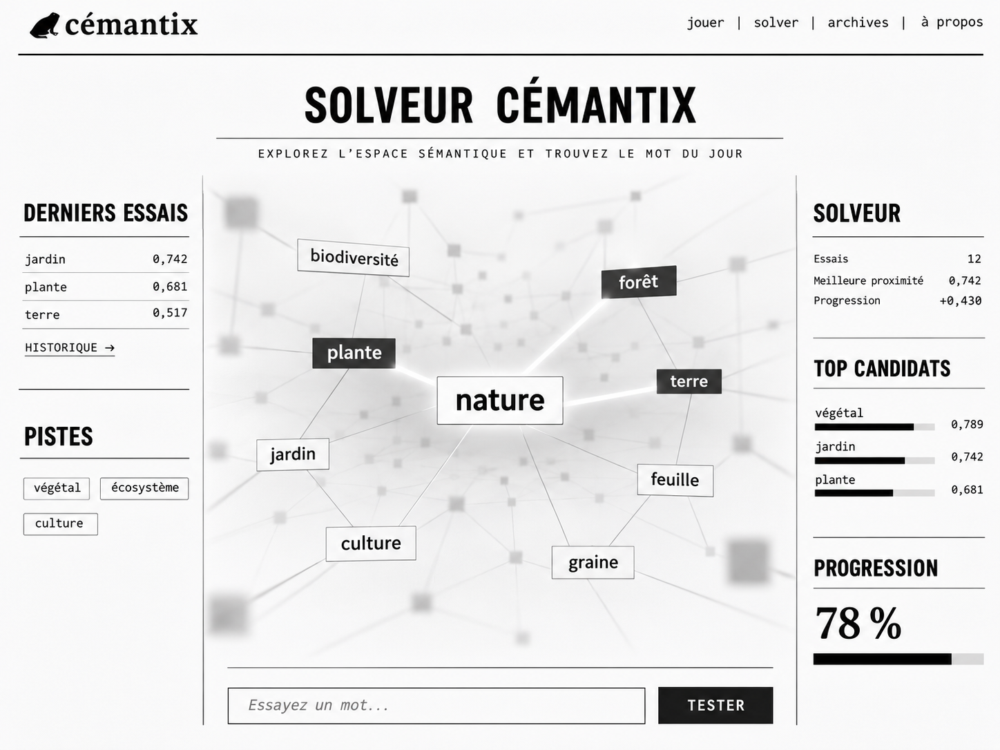

# Refonte de l’atelier Cémantix — suivi UI/UX

La référence donne la première place au mot. Le regard part de « nature », suit les liens vers les mots voisins, puis descend vers « Tester ». Les marges servent à deux lectures complémentaires : à gauche, ce que le joueur a déjà tenté ; à droite, ce que le solveur en déduit.

**Point de départ · sprint 16.** L’atelier utilise aujourd’hui un bandeau vert, une jauge circulaire, une courbe de recherche et un journal détaillé. Les cases ci-dessous suivent l’application du nouveau design. Cocher une ligne après avoir vérifié son critère dans l’interface et inscrire le sprint de livraison en fin de ligne. Les trois décisions en fin de document demandent une validation avant de modifier la structure de l’atelier. [Langage visuel actuel](../design_language.md)

## 1. Composition et identité

- [ ] **Grille de bureau.** Sur l’image de 1 448 × 1 086 px, les filets verticaux se situent vers x = 294 et x = 1 153. Viser environ 19 % / 62 % / 19 % de la largeur intérieure. L’en-tête et le titre traversent les colonnes. Le graphe et la commande de jeu partagent le même axe central.
- [ ] **Papier, encre et filets.** Le fond blanc cassé traverse toute la page. Le noir sert aux titres, au bouton principal et aux données fortes. Deux gris distinguent les séparations et les pistes des barres. Définir ces rôles dans les tokens de couleur et les reprendre dans les dessins sur canvas. Les sections se lisent grâce aux filets, aux espacements et aux alignements sur ce fond commun.
- [ ] **Typographie par fonction.** Le mot-symbole est en bas de casse avec empattements. Le titre « Solveur Cémantix » et les rubriques sont en capitales grasses et condensées. La navigation, les listes et les mesures sont à chasse fixe. Les mots du graphe utilisent une sans empattement plus large. Vérifier la distinction de ces quatre rôles et l’alignement des décimales ; les familles exactes ne sont pas identifiables sur la capture.
- [ ] **En-tête.** À gauche, une silhouette noire de grenouille précède « cémantix ». À droite, les entrées de navigation sont séparées par des traits verticaux. Un filet noir ferme le bandeau. Tester le logo fourni sur fond clair, l’accès à l’accueil et le repérage de la vue active au clavier.
- [ ] **Titre et respiration.** Le grand titre centré domine la page. Un filet plus court que le bandeau le sépare d’une ligne de texte en petites capitales espacées. À reproduire sur l’atelier avec une phrase qui explique l’action du joueur et reste lisible sur deux lignes en largeur réduite.

## 2. Surface de jeu centrale

- [ ] **Mot focal.** « nature » apparaît dans le plus grand cartouche, clair et bordé, au point de convergence des liens. Y placer le mot recommandé, puis le mot confirmé en fin de partie. Son rôle doit être annoncé par un libellé et un mot long doit rester lisible en entier.
- [ ] **Réseau au premier plan.** « plante », « forêt » et « terre » apparaissent en blanc sur noir, reliés au centre par des traits clairs épais. Les autres mots, dont « jardin » et « feuille », occupent des cartouches clairs reliés par des traits fins. Après validation du sens des liens, vérifier sur une vraie partie que chaque mot, chaque relation et chaque style de nœud sont explicables.
- [ ] **Profondeur du graphe.** Des nœuds carrés gris, des traits fins et un flou croissant donnent du relief à l’arrière-plan. Garder cette couche décorative hors de la lecture assistée. Le décor ne doit gêner ni la lecture des mots, ni le contraste des cartouches, ni l’interaction.
- [ ] **Commande d’essai.** Sous un filet, un champ rectangulaire occupe l’essentiel de la largeur, suivi du bouton noir « Tester » en capitales. En mode assisté, relier la saisie au parcours existant d’enregistrement du résultat. En simulation et sur la grille du jour, conserver les actions « Jouer un essai » et « Mode automatique ». Vérifier le libellé du champ, la touche Entrée et le blocage des doubles soumissions pendant le calcul.

## 3. Marges de lecture

| Zone de la référence | Détail observé | Critère de livraison dans l’atelier |
| --- | --- | --- |
| Derniers essais, en haut à gauche | Trois lignes « mot / valeur », chiffres alignés à droite, filets fins. Lien « Historique → » souligné. | Montrer les essais les plus récents et leur résultat réel en °C, ou « Refus » / « Victoire ». Le lien rejoint le journal complet de la partie. |
| Pistes, en bas à gauche | « végétal », « écosystème » et « culture » dans de petits rectangles à contour fin qui reviennent à la ligne. | Chaque piste provient d’une source définie. Si elle remplit le champ, le joueur garde la main sur l’envoi. |
| Solveur, en haut à droite | « Essais », « Meilleure proximité » et « Progression » forment trois paires libellé–valeur. | Afficher les essais joués et la meilleure température observée avec son unité. Pour toute variation affichée, identifier la mesure et le point de comparaison. |
| Top candidats, à droite | Chaque mot surmonte une barre noire sur piste grise. La valeur numérique se lit au bout de la ligne. | Reprendre le classement et les probabilités estimées du moteur. Un affichage à 0,742 dans la maquette ne suffit pas à établir qu’il s’agit d’une probabilité. Dans l’atelier, annoncer le pourcentage et préciser les ex æquo. |
| Progression, en bas à droite | Une grande valeur « 78 % » domine une barre rectiligne sous un filet. | Avec l’option « Budget utilisé », la valeur et la barre indiquent toutes deux essais joués / budget. Le nombre d’essais restants demeure visible, y compris à zéro. |

**Validation par rubrique**

- [ ] Derniers essais et accès au journal vérifiés sur une partie contenant plus de trois essais.
- [ ] Pistes vérifiées avant le premier essai et après une nouvelle recommandation.
- [ ] Indicateurs du solveur vérifiés sans score puis avec deux températures, dont une négative.
- [ ] Classement vérifié avec plusieurs candidats équiprobables, un seul candidat et aucun candidat.
- [ ] Progression vérifiée au premier essai, à la victoire avant la limite et à l’épuisement du budget.

## 4. Parcours et écrans complémentaires

La capture montre un seul écran de bureau. Les adaptations suivantes prolongent son langage visuel dans les parcours existants.

- [ ] **Mobile.** À 375 px, présenter d’abord le mot, les essais restants et l’action de jeu, puis les derniers essais et les candidats. Vérifier qu’un long mot accentué, un zoom à 200 % et le clavier de saisie laissent la commande accessible. Le tableau détaillé peut défiler dans sa section.
- [ ] **Lecture et clavier.** Fournir un équivalent textuel du graphe. Vérifier l’ordre du focus, son contour visible sur fond clair et noir, ainsi que l’annonce du résultat après un essai. Les statuts et les mesures doivent rester compréhensibles lorsque le décor est masqué.
- [ ] **Chargement, vide et erreur.** Contrôler l’initialisation, le journal vide, le calcul en cours, la coupure du moteur et la reprise. Chaque état indique ce qui se passe et l’action disponible. Une partie suspendue, interrompue ou résolue doit rester identifiable en monochrome.
- [ ] **Mes parties et dialogues.** Étendre les mêmes titres, filets, contrôles et espacements aux archives, à la création, à la saisie d’un score et à la confirmation de suppression. Ouvrir une partie archivée, annuler une suppression et revenir au déclencheur au clavier.
- [ ] **Détail de résolution.** Depuis le résumé, retrouver la trajectoire par mesure, la stratégie active, le diagnostic et le journal avec export JSON. Vérifier ce parcours sur un historique comportant un changement de modèle.

## Décisions à valider avant l’intégration

| Décision | Proposition | Conséquence pour le joueur |
| --- | --- | --- |
| Que représente une arête ? | Commencer avec les relations connues entre la recommandation, les candidats et les essais d’une partie. Une carte de distances lexicales demanderait des similarités entre mots que la vue actuelle ne fournit pas. Décider aussi si les « Pistes » reprennent des candidats sélectionnables. | Le joueur peut expliquer pourquoi deux mots sont reliés et ce qu’un clic sur une piste déclenche. |
| Que signifie « Progression » ? | Utiliser « Budget utilisé » pour la grande jauge. Dans le résumé, préférer un écart de température entre essais chiffrés successifs, exprimé en °C. | Un succès au troisième essai sur vingt affiche à la fois « Victoire » et un budget utilisé de 15 %. |
| Où mène la navigation ? | Reprendre le rythme visuel de « jouer / solver / archives / à propos » pour les destinations existantes « Atelier » et « Mes parties ». Garder « Nouvelle partie » accessible depuis les deux vues. | Un historique d’essais ouvre le journal courant ; « Mes parties » permet de changer de session. |
